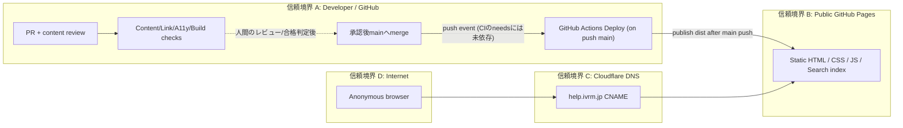
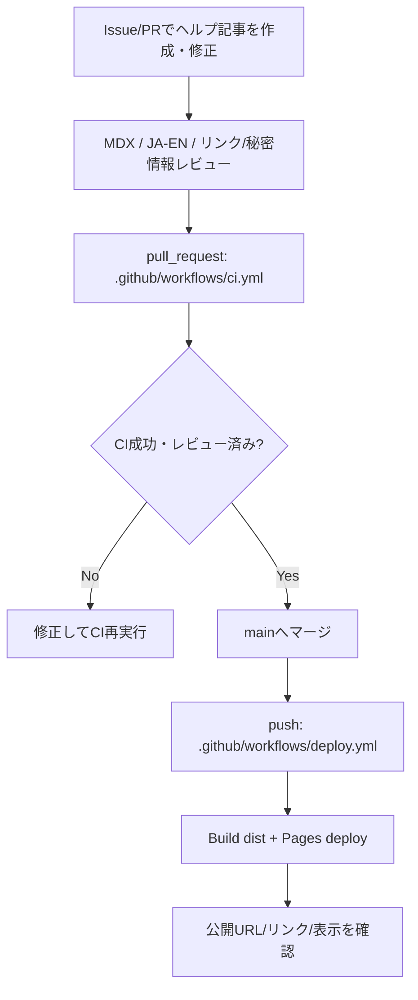
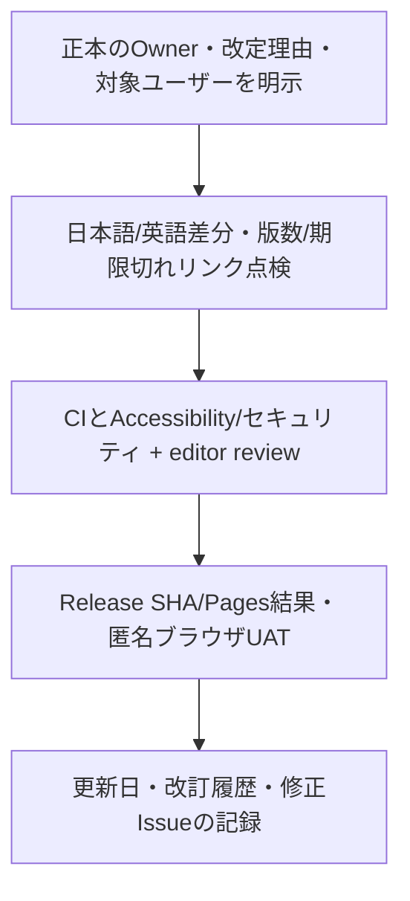

# IVRM Help Center — 要件定義・基本/詳細設計・構成・フロー

Reviewed: 2026-10-26 JST. Evidence: `astro.config.mjs`, `src/content.config.ts`, `src/content/docs/**`, `scripts/check-*.mjs`, `.github/workflows/{ci,deploy}.yml`. GitHub main実装との照合であり、Pagesの実本番Releaseや閲覧者UATは未検証。

## 要件定義

- 参加者は `help.ivrm.jp` でコミュニティ・Discord・Minecraft・サポートの手順/ルールを閲覧できる。
- 日本語をデフォルトとし、`src/content/docs/en/**` に英語ページを保持する。ただし英語の翻訳網羅を保証しない。
- 正規の接続先/Modpack/Whitelistや参加条件など運用で変更される情報は、公式Discordの最新案内を確認する必要がある（例: `src/content/docs/minecraft/how-to-join.mdx`）。
- 管理機能・ログイン/個人情報・DB操作は本サイトの責務外。ユーザーからの障害報告は `support/report-a-problem.mdx` の形式で必要最小限の情報のみ共有する。
- 文書公開に際し、秘密鍵/Token/個人情報・内部IP/Server admin port等をGitHub Pagesに出さない。

## 基本設計・環境構成

| Component | Owner | Source of Truth |
| --- | --- | --- |
| Static Content | `src/content/docs/**` (JA/EN) | Markdown/MDX, Astro Starlight |
| Layout & Navigation | `astro.config.mjs`, `src/components/**` | Starlight sidebar, locale, theme |
| Build/Runtime | GitHub Actions -> GitHub Pages | `.github/workflows/deploy.yml`, `dist/` |
| DNS | Cloudflare CNAME + Pages domain setting | `README.md`; 実DNS/Providerは要照合 |
| Access control | Content is public; no site-local auth | 個人情報を公開コンテンツへ載せない |
| Service help integration | Discord/Minecraft/ivrm-webへの案内 | 相手サービスの本番仕様が正本 |

## システム/ネットワーク構成図（論理図）

**確認範囲:** DNS CNAME、Pages settings、配布bundleは実Providerでread-only確認が必要。Cloudflare Tunnel、AWS EC2、Herta DBへサイトから直接接続するという根拠はない。

## 業務フロー AS-IS（Repo実装）

## TO-BE（追加の品質管理案、未実装）

本サイトは独立DBもサーバーAPIも持たないため、DB設計書・テーブル定義・ER図・API仕様は**対象外 (N/A)**。外部APIやDiscord botの仕様を本Repositoryにコピーせず、OwnerのDocsへリンクする。Site search indexはビルド成果物でありトランザクションDBではない。

## 詳細設計・UI

- Static routesは `src/content/docs` のStarlight slug+localeが正本。
- 日本語・英語の現在の公開ページ集合はtreeから取得し、未翻訳ページを「英語公開済み」として扱わない。
- Sidebar nav: `astro.config.mjs`。日本語はMinecraft Main Server/Mods/接続・Troubleshooting・Discord・Supportを含む。
- 初期 `SITE_URL=https://ivrooom.github.io` / `BASE_PATH=/ivrm-help` はGitHub Pages project-site用フォールバック設定。実際の`help.ivrm.jp` baseと公開URLはRepo varsとPages設定で確認し、単なるCNAMEだけで変更しない。
- Search、レスポンシブUI、404、外部リンク/Alt/Focus等はBuildとブラウザの両方でチェックする。

## 重要な変更境界

`main` pushでPagesへ**自動デプロイ**。Markdown-onlyの修正でも公開処理が起動する。PRの中でタイトル/リンク/対象読者/実際の影響（JA/EN）とCI・Preview/手動表示検証の証拠を確認し、独立の公開承認を得てからマージする。
